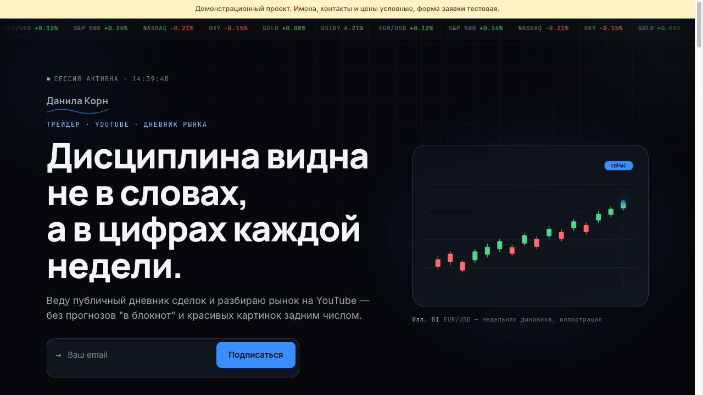

# SiteViza — сайт трейдера

Личный сайт автора YouTube-канала о рынках: дневник сделок, подписка, форма обращения.

> **Демонстрационный проект.** Имена, контакты, адреса и цены на сайте условные и показаны как пример; форма заявки тестовая.

**Онлайн:** https://siteviza.gonka.blog



## Что внутри

- Результаты недели читаются из `data/results.json`
- Имя, ссылки и подпись настраиваются в `data/config.js`
- Подписка на материалы и форма обращения пишут в разные листы таблицы

## Стек

чистые HTML / CSS / JavaScript, Google Apps Script, Google Таблицы. Сборка не нужна: это статические файлы.

## Запуск

`cd frontend && python3 -m http.server 8000`

## Структура

```
siteviza/
├── frontend/
└── docs/            скриншоты
```

## Автор

Олег, [GitHub: textsmen-design](https://github.com/textsmen-design).
